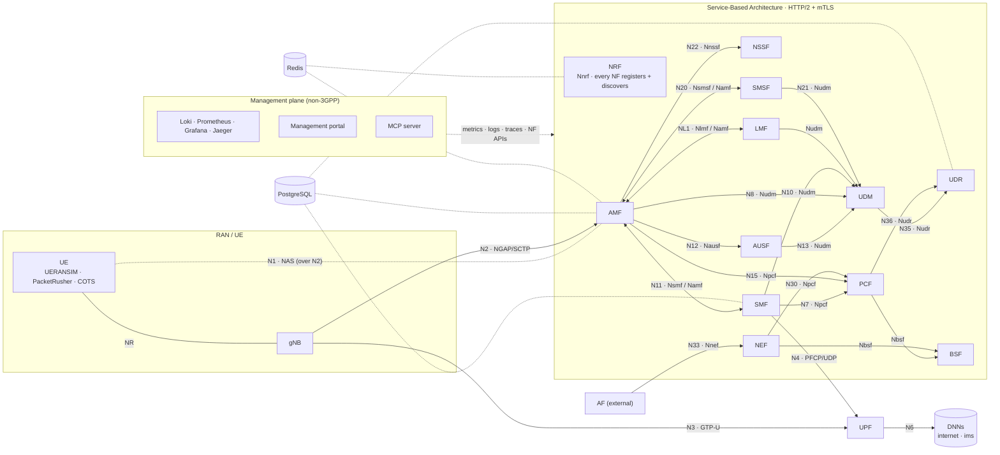

# ClaudIA 5GC

[](https://github.com/francurieses/claudia-5gc/actions/workflows/ci.yml)


[](LICENSE)

**A from-scratch, spec-faithful 5G Core (Standalone, 3GPP Rel-17) in Go — 13 network functions in Docker, Wireshark-clean N1/N2/N4/N3, validated with UERANSIM, PacketRusher, and a commercial gNB with COTS 5G handsets.**

[Quickstart](#quickstart) · [Network Functions](#network-functions) · [Features](#features) · [Docs](#documentation)

## Why ClaudIA 5GC

ClaudIA 5GC is an open-source 5G Core built to be developed and operated with AI, not just run next to it. An integrated MCP server lets LLM clients inspect, test and control the core in natural language, covering NF status, NAS decoding, traces and QoS policy. The same AI-assisted workflow shortens the path from idea to validated feature. New procedures and NFs take a fraction of the time of traditional telecom development, so innovation and validation move faster. The cloud-native, containerized SBA scales horizontally, one NF per container. A web portal handles day-to-day operation, and logs, metrics, traces and dashboards come wired in by default. The result is a Release 17 core you can bring up in minutes and debug, extend and automate, with people and AI agents working on the same system.

## Architecture



Every NF registers with and discovers its peers through the NRF (Nnrf edges omitted). PostgreSQL and Redis are per-NF state stores, not SBI peers; there is no UDSF. The portal and MCP server are management-plane clients that call NF APIs directly rather than through the NEF. Full diagrams and per-NF detail: [`docs/architecture.md`](docs/architecture.md).

## Quickstart

Prerequisites: Docker ≥ 24 usable without `sudo`, Docker Compose v2, GNU Make (Node 18+ only for the portal). Details and troubleshooting: [`docs/getting-started.md`](docs/getting-started.md#prerequisites).

```bash
git clone https://github.com/francurieses/claudia-5gc && cd claudia-5gc
make pki        # dev CA + one certificate per NF (first time only)
make ueransim   # 13 NFs + observability + UERANSIM gNB + 1 UE (UE_COUNT=N for more)
docker exec ueransim-ue nr-cli --dump                       # the UE reaches MM-REGISTERED
docker exec ueransim-ue ping -I uesimtun0 -c3 8.8.8.8       # user-plane through the UPF
make down       # stop and remove volumes
```

Want everything (portal + 4 slices with one UE each)? `make full`, then open the portal.

| Service | URL |
|---------|-----|
| Management portal | http://localhost:8080 |
| Grafana (admin/admin, dev only) | http://localhost:3000 |
| Jaeger | http://localhost:16686 |
| Prometheus | http://localhost:9090 |

## Screenshots

<!-- TODO(maintainer): add docs/assets/*.png — portal dashboard, UE Location map, Grafana 5G KPI dashboard, Wireshark NGAP/NAS decode. -->
Screenshots are coming soon. Run `make full` to see the portal, Grafana and Jaeger yourself.

## Network Functions

✅ operational · 🟡 implemented with documented scope limits (see [implementation status](docs/implementation-status.md)).

| NF | | Services / interfaces | Highlights |
|----|---|-----------------------|------------|
| [NRF](nf/nrf/) | ✅ | `Nnrf_NFManagement`, `Nnrf_NFDiscovery`, OAuth2 | Heartbeat eviction, Subscribe/Notify, DNN/S-NSSAI filters, Redis registry |
| [AMF](nf/amf/) | ✅ | N1, N2, `Namf_*` | Registration, Service Request, Xn/N2 handover, paging, NSSAA, PWS, UE context transfer |
| [SMF](nf/smf/) | ✅ | N4, `Nsmf_*` | PDU sessions IPv4/IPv6/IPv4v6, QoS modification, secondary auth, per-DNN pools |
| [UPF](nf/upf/) | ✅ | N3, N4, N6, N9-ready | GTP-U, QER/URR, per-DNN TUN, IPv6 egress |
| [AUSF](nf/ausf/) | 🟡 | `Nausf_UEAuthentication` | 5G-AKA, EAP-AKA′, NSSAA relay |
| [UDM](nf/udm/) | 🟡 | `Nudm_UEAU/UECM/SDM` | SUCI null + Profile A, SDM Subscribe/Notify, LCS privacy |
| [UDR](nf/udr/) | ✅ | `Nudr_DataRepository` | PostgreSQL, subscriber + policy data |
| [PCF](nf/pcf/) | ✅ | N7, N15, `Npcf_*` | SM policy lifecycle, AM policy, URSP, DNN-scoped QoS overrides |
| [NSSF](nf/nssf/) | ✅ | `Nnssf_NSSelection` | Allowed-NSSAI selection |
| [SMSF](nf/smsf/) | 🟡 | `Nsmsf_SMService` | SMS over NAS |
| [BSF](nf/bsf/) | ✅ | `Nbsf_Management` | PCF binding registry |
| [NEF](nf/nef/) | 🟡 | `Nnef_AFsessionWithQoS` | AF-requested QoS via BSF + PCF |
| [LMF](nf/lmf/) | 🟡 | `Nlmf_Location` | Cell-ID, E-CID (NRPPa), A-GNSS (LPP), event subscriptions |
| [MCP](mcp/) | ✅ | stdio + HTTP/SSE `:9300` | LLM-facing tool server (not a 3GPP NF) |

## Features

Clause-level status for every procedure: [`docs/compliance-matrix.md`](docs/compliance-matrix.md). Each row below has a procedure doc under [`docs/procedures/`](docs/procedures/).

### Registration & security

| Feature | Spec |
|---------|------|
| Initial, mobility and periodic registration; UE- and NW-initiated deregistration | TS 23.502 §4.2.2 |
| 5G-AKA, SUCI null-scheme and Profile A (X25519) | TS 33.501 §6.1, §6.12 |
| NAS security NIA1/NIA2 + NEA0/NEA1/NEA2 | TS 33.501 §6.7 |

<details><summary>More registration & security</summary>

| Feature | Spec |
|---------|------|
| EAP-AKA′ | RFC 5448, TS 33.501 §6.1.3.1 |
| Network Slice-Specific Authentication (NSSAA) | TS 23.502 §4.2.9 |
| Service Area Restriction | TS 23.501 §5.3.4 |
| UE configuration update | TS 23.502 §4.2.4 |

</details>

### Session management

| Feature | Spec |
|---------|------|
| PDU session establishment, modification, release — IPv4, IPv6, IPv4v6 | TS 23.502 §4.3.2–4.3.4 |
| 5QI selection (PCF > UDM > default), QER, NW-initiated QoS modification | TS 23.501 §5.7, TS 23.502 §4.3.3.2 |
| Per-DNN subnet isolation (internet / ims) | TS 23.501 §5.6.5 |

<details><summary>More session management</summary>

| Feature | Spec |
|---------|------|
| Secondary authentication / DN-AAA | TS 23.502 §4.3.2.3 |
| PFCP usage reporting (URR) | TS 29.244 §5.2.2.4 |
| NW-triggered additional PDU session (via URSP) | TS 23.503 §6.6.2 |

</details>

### Mobility & connection management

| Feature | Spec |
|---------|------|
| AN release → CM-IDLE, Service Request with UP re-activation | TS 23.502 §4.2.3 |
| CN paging / network-triggered Service Request | TS 23.502 §4.2.3.3 |
| Xn handover (PathSwitch) and N2 handover | TS 23.502 §4.9.1.2, §4.9.1.3 |

<details><summary>More mobility</summary>

| Feature | Spec |
|---------|------|
| UE context transfer (`Namf_Communication`) | TS 29.518 §5.3.2 |
| Lifecycle timers T3512, mobile-reachable, implicit detach | TS 23.502 §4.2.2.2.4 |

</details>

### Policy, location, messaging and exposure

<details><summary>Policy</summary>

| Feature | Spec |
|---------|------|
| SM policy create / update / delete | TS 29.512 §5.2.2 |
| AM policy association | TS 29.507 |
| URSP delivery in a UE policy container (MANAGE UE POLICY COMMAND) | TS 24.501 Annex D, TS 29.525 |

</details>

<details><summary>Location</summary>

| Feature | Spec |
|---------|------|
| Cell-ID positioning, deferred MT location with paging | TS 23.273 §6, §7.2 |
| Enhanced Cell-ID via NRPPa relay (APER) | TS 38.455 |
| A-GNSS via LPP relay over N1 | TS 37.355 |
| Event subscription, cancel, location privacy | TS 29.572 §5.2.3 |

</details>

<details><summary>Messaging & exposure</summary>

| Feature | Spec |
|---------|------|
| SMS over NAS (SMSF) | TS 23.502 §4.13.3, TS 23.501 §5.20 |
| Public Warning System (Write-Replace Warning / Cancel) | TS 23.041, TS 38.413 §8.9 |
| PCF binding (BSF) and AF session with QoS (NEF) | TS 29.521, TS 29.522 §4.4.13 |

</details>

<details><summary>Service-based architecture</summary>

| Feature | Spec |
|---------|------|
| NF register, discover, subscribe, heartbeat | TS 29.510 §5 |
| OAuth2 + mTLS over HTTP/2 | TS 29.500 §4.4, TS 33.501 §13 |

</details>

## Management portal

`make portal` (or `make full`) serves the portal at http://localhost:8080 — light/dark themes, 13 pages in 6 groups: dashboard with 3GPP KPI charts (TS 28.554), subscribers, slices, services, sessions, QoS, policies, UE location, UERANSIM, PacketRusher, logs, PCAP and Public Warning. Details: [`tools/mgmt-portal/`](tools/mgmt-portal/).

## AI-native development

The MCP server in [`mcp/`](mcp/) speaks stdio and HTTP/SSE (`:9300`) and offers tools for NAS encode/decode, NF discovery, UE and session inspection, traces and KPIs, QoS control and UERANSIM control.

## Repository layout

```
nf/<name>/           One folder per NF (Dockerfile, cmd/, internal/, config/, tests/)
nf/_template/        Template for new NFs (scripts/new-nf.sh)
shared/              nas · ngap · nrppa · lpp · pfcp · gsm7 · crypto · aka · oauth2 · sbi · nrf · logging · observability · types
mcp/                 MCP server
tools/mgmt-portal/   Management portal (Go + React)
tools/ueransim/      UERANSIM build + patch set
observability/       Loki, Prometheus, Grafana, Promtail
config/              Operator, UERANSIM and PacketRusher configs
docs/                Getting started, architecture, procedures, status, compliance matrix
specs/3gpp-openapi/  3GPP Rel-17 OpenAPI YAMLs
scripts/             PKI, test suites, PCAP control
```

## Documentation

| Doc | What it is for |
|-----|----------------|
| [`docs/getting-started.md`](docs/getting-started.md) | Prerequisites, Make reference, scenarios, UERANSIM usage |
| [`docs/implementation-status.md`](docs/implementation-status.md) | What is implemented per NF |
| [`docs/compliance-matrix.md`](docs/compliance-matrix.md) | Clause-level 3GPP traceability |
| [`docs/procedures/`](docs/procedures/) | One document per procedure: sequence diagram, IEs, error cases |
| [`docs/validation-commands.md`](docs/validation-commands.md) | Validation recipes and T0–T9 suite |
| [`docs/pcap-diagnostics.md`](docs/pcap-diagnostics.md) | NGAP / NAS / HTTP2 troubleshooting with PCAPs |
| [`docs/ran-integration-guide.md`](docs/ran-integration-guide.md) | Connecting a real gNB and UEs |
| [`docs/architecture.md`](docs/architecture.md) | Architecture overview |
| [`CONTRIBUTING.md`](CONTRIBUTING.md) · [`SECURITY.md`](SECURITY.md) | Contribution rules, security policy |

## Contributing

Read [`CONTRIBUTING.md`](CONTRIBUTING.md). Commits look like `feat(amf): implement X [TS 23.502 §4.2.2.2.2]`. Each new procedure follows the same flow: procedure doc → Cucumber feature → implementation → step definitions → integration test → PCAP validation → compliance matrix.

## License

[Apache-2.0](LICENSE). Original code © 2026 Francisco Curieses. No Open5GS (AGPL) code is used.

| Third-party | Use | License |
|-------------|-----|---------|
| [UERANSIM](https://github.com/aligungr/UERANSIM) | RAN simulator, built at image time, not vendored | GPL-3.0 |
| [PacketRusher](https://github.com/HewlettPackard/PacketRusher) | Xn / N2 handover scenarios, built at image time | Apache-2.0 |
| [free5gc/aper](https://github.com/free5gc/aper), [free5gc/ngap](https://github.com/free5gc/ngap) | APER codec and NGAP types (codec reference) | Apache-2.0 |
| [wmnsk/go-pfcp](https://github.com/wmnsk/go-pfcp) | PFCP messages | MIT |
| [ishidawataru/sctp](https://github.com/ishidawataru/sctp) | SCTP sockets for N2 | Apache-2.0 |
