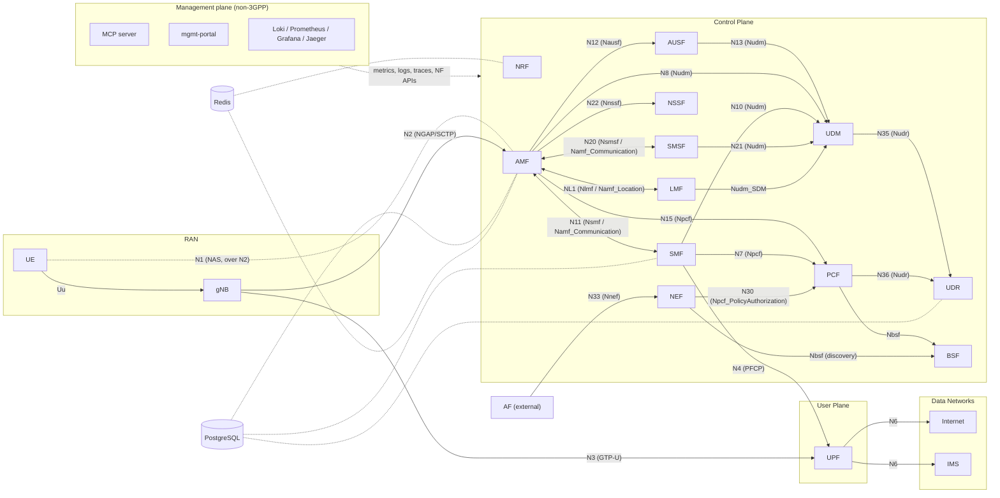

<!-- tier: public -->
# Architecture Overview

This doc captures the high-level design decisions. For what is implemented, see [`implementation-status.md`](implementation-status.md) and [`features.md`](features.md). For per-NF detail, see the NF folder under `nf/<nf>/`; per-procedure designs and conformance are in the [members documentation](https://www.claudia5gc.dev/docs/members/).

## Reference architecture

All control-plane NFs register with and discover each other through the NRF (Nnrf edges omitted for readability).

### Reference points

Only relations implemented in code are drawn. Where both NFs call each other, the edge is bidirectional.

| Ref. point | Between | Services used | Notes |
|---|---|---|---|
| N1 | UE – AMF | NAS-5GS | Logical; carried over N2 |
| N2 | gNB – AMF | NGAP/SCTP | |
| N3 | gNB – UPF | GTP-U | |
| N4 | SMF – UPF | PFCP | |
| N6 | UPF – DN | IP | One network per DNN |
| N7 | SMF – PCF | Npcf_SMPolicyControl | |
| N8 | AMF – UDM | Nudm_UECM, Nudm_SDM | AMF registration + am-data |
| N10 | SMF – UDM | Nudm_SDM | sm-data only; no SMF registration in UDM |
| N11 | AMF – SMF | Nsmf_PDUSession; Namf_Communication (N1N2 transfer) | SMF → AMF for paging and secondary authentication |
| N12 | AMF – AUSF | Nausf_UEAuthentication, Nausf_NSSAA | |
| N13 | AUSF – UDM | Nudm_UEAuthentication | |
| N15 | AMF – PCF | Npcf_AMPolicyControl, Npcf_UEPolicyControl | |
| N20 | AMF – SMSF | Nsmsf_SMService; Namf_Communication (N1N2 transfer) | SMSF → AMF for MT SMS |
| N21 | SMSF – UDM | Nudm_UECM | SMSF registration only |
| N22 | AMF – NSSF | Nnssf_NSSelection | |
| N30 | NEF – PCF | Npcf_PolicyAuthorization | After PCF binding lookup in BSF |
| N33 | AF – NEF | Nnef AsSessionWithQoS | NEF API is served; no AF is shipped |
| N35 | UDM – UDR | Nudr_DataRepository | Subscription data |
| N36 | PCF – UDR | Nudr_DataRepository | Policy data |
| NL1 | AMF – LMF | Nlmf_Location; Namf_Location | LMF → AMF for DL NRPPa / LPP relay |
| — | LMF – UDM | Nudm_SDM | LCS privacy data |
| — | PCF, NEF – BSF | Nbsf_Management | No numbered reference point |

Not implemented: N37 (NEF – UDR), N40 (CHF), N9 (I-UPF), SCP, UDSF.

### Non-3GPP components

- **PostgreSQL** holds UDR subscriber data, AMF UE contexts, SMF sessions and portal data. **Redis** backs the AMF cache and the NRF registry. They are per-NF stores, not SBI peers, and there is no UDSF (Nudsf).
- **MCP server** and **mgmt-portal** are management-plane clients. They call NF APIs directly (NRF, SMF `nsmf-management`, UDM, the AMF management API on 9002; the portal also UDR, PCF and LMF), not through the NEF.
- **Observability** scrapes `/metrics` and container logs and receives OTLP traces; it is not an SBI consumer.

## Key architectural decisions

| Decision | Choice | Rationale |
|---|---|---|
| Communication model | Direct, with NRF discovery; no SCP | TS 23.501 Annex E models A/B |
| Transport for SBI | HTTP/2 + TLS 1.3, mTLS | TS 29.500 §6.2 |
| Auth for SBI | OAuth2 client_credentials, NRF as AS | TS 33.501 §13.4.1 |
| Service discovery | NRF (no DNS-SD) | TS 23.501 §6.3.1 |
| Internal NF storage | Per-NF state in process (PostgreSQL / Redis backed); UDR for subscriber data; charging not implemented | Avoid sharing state between NF instances |
| Codecs (NGAP/NAS) | Reuse `github.com/free5gc/aper` (Apache-2.0) | Avoid reimplementing ASN.1 PER |
| UPF data plane | Userspace Go datapath: per-DNN TUN (`upfgtpN`) + iptables MASQUERADE; Rust + eBPF/XDP later | Pragmatic MVP, scale later |
| Kubernetes vs Compose | Compose | Fewer moving parts during development |
| Service mesh | None | SBA already has NRF; mesh breaks SBI tracing |

## Deployment modes

The default deployment is a **standalone deployment (core-only)**: the NFs, observability and the
portal run with no RAN simulator built or started. RAN simulators are opt-in through the root
Makefile variable `RAN` (compose profiles in parentheses):

| `RAN=` | Running next to the core | Compose profiles added |
|---|---|---|
| `none` (default) | nothing | — (`core`, `observability`, `tools` as requested) |
| `ueransim` | UERANSIM gNB + UEs | `integration-ueransim` |
| `packetrusher` | PacketRusher dual-gNB (`PR_SCENARIO=xn\|n2\|none`) | `handover` / `handover-n2` |
| `both` | both | all of the above |

The mgmt-portal detects the mode at runtime from the running containers (`GET /api/v1/deployment`, override
`PORTAL_RAN_TOOLS`) and hides the UERANSIM / PacketRusher pages when absent. The **gNBs (RAN)** page works in
every mode because its data comes from the AMF, not from Docker: the AMF gNB registry is served on the
management port `GET :9002/amf/v1/ran/gnbs` (plain HTTP, read-only). Commands: [`getting-started.md`](getting-started.md).

## Network topology (Docker)

| Network | Subnet | Purpose | Members |
|---|---|---|---|
| sbi-net | 172.30.0.0/24 | HTTP/2 SBI between control-plane NFs | All CP NFs, postgres, redis |
| n2-net | 172.30.1.0/24 | NGAP/SCTP between gNB and AMF | AMF, gNB simulators |
| n4-net | 172.30.2.0/24 | PFCP between SMF and UPF | SMF, UPF |
| n3-net | 172.30.3.0/24 | GTP-U between gNB and UPF | UPF, gNB simulators |
| n6-net | 172.30.6.0/24 + `fd00:6::/64` | UPF egress for the `internet` DNN | UPF |
| n6-ims-net | 172.30.7.0/24 + `fd00:7::/64` | UPF egress for the `ims` DNN | UPF |
| obs-net | (Docker-assigned) | Observability | Loki, Prometheus, Grafana, Jaeger, NFs |

`perf` profile (opt-in benchmarking, headline figures in [`performance/summary.md`](performance/summary.md)): `iperf3-dn` 172.30.6.50 and `gtpu-bench-dn` 172.30.6.51 on n6-net; `gtpu-bench` 172.30.3.20 on n3-net + n4-net; `iperf3-upf-local` shares the UPF network namespace (10.60.0.254). iperf3 ports: 5201-5216 (`iperf3-dn`), 5301-5316 (`iperf3-upf-local`); none are published to the host.

UE IP pools are per DNN (`10.60.0.0/24` internet, `10.61.0.0/24` ims, …); the single source of truth is `config/operator.yaml`. There is no N9 network yet (no I-UPF).

## Ports

| Component | Service port(s) | Metrics |
|---|---|---|
| NRF | 8000 (SBI) | 9100 |
| AMF | 8001 (SBI), 9002 (management API), 38412/sctp (N2) | 9101 |
| AUSF | 8002 | 9102 |
| UDM | 8003 | 9103 |
| UDR | 8005 | 9104 |
| SMF | 8004 | 9105 |
| PCF | 8006 | 9106 |
| UPF | 8805/udp (N4), 2152/udp (N3) | 9107 |
| NSSF | 8007 | 9109 |
| SMSF | 8009 | 9110 |
| BSF | 8010 | 9111 |
| NEF | 8011 | 9112 |
| LMF | 8012 | 9113 |
| MCP server | 9300 (SSE) | — |
| Management portal | 8080 | — |

### RAN simulator addressing

No port collision exists between UERANSIM and PacketRusher: each simulator runs in its own network namespace and every gNB has its own IP. NGAP uses SCTP PPID 60 (TS 38.412 §7); GTP-U stays on 2152 (TS 29.281 §4.4.2.3).

| Endpoint | N2 (5gc-n2 / n2-net) | N3 (n3-net) | gNB ID / NCI |
|---|---|---|---|
| Core: AMF N2 listener | 172.30.1.2:38412/sctp | — | — |
| Core: UPF N3 listener | — | 172.30.3.100:2152/udp | — |
| UERANSIM `ueransim-gnb` | dynamic IP, ephemeral SCTP local port | 172.30.3.3 | gNB-ID `0x00000001` (32-bit), nci `0x000000010` |
| UERANSIM `ueransim-gnb-ms` | dynamic IP | 172.30.3.4 | gNB-ID `0x10`, nci `0x000000100`; own aliases `ueransim-gnb-ms` / `ueransim-gnb-ms-n3`, so it runs next to `ueransim-gnb` (`make ueransim-all`) |
| PacketRusher gNB1 | 172.30.1.20:9487 | 172.30.3.10:2152 | gNB-ID `000002` (24-bit) |
| PacketRusher gNB2 (handover) | 172.30.1.21:9488 | 172.30.3.11:2152 | gNB-ID `000003` |

`docker/packetrusher/entrypoint.sh` runs ARP duplicate-address detection before adding the secondary `.21`/`.11` addresses (exits 1 with a clear message if taken) and then a gratuitous ARP. Verify with `curl -s localhost:9002/amf/v1/ran/gnbs` (all gNBs `NG_READY`).

## Observability

Three pillars, all wired from Day 0:

1. **Logs** — JSON to stdout per NF, scraped by Promtail, indexed by Loki, queried via Grafana. 3GPP-aware fields (SUPI, GUTI, correlation_id, spec_ref) enforced by `shared/logging`.
2. **Metrics** — Prometheus, scraped from each NF on its metrics port (9100–9113, see above). Standard set: `fivegc_sbi_requests_total`, `fivegc_sbi_request_duration_seconds`, plus per-procedure/timer metrics.
3. **Traces** — OpenTelemetry to Jaeger via OTLP. Per-procedure trace, spans per SBI call and per N1/N2/N4 message.

Plus PCAP per NF via tcpdump sidecar. Wireshark dissects NGAP, NAS-5GS, PFCP, GTP-U, and HTTP/2 SBI natively.
